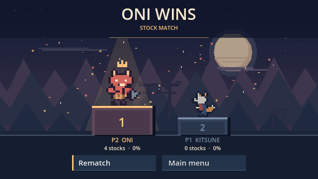

# Thrash Fighters

Thrash Fighters is a Windows platform fighter starring spirits from Japanese folklore. Play a solo or local match, or practice wavedashes, L-cancels, and combos in training mode.

See the [development plan](DEVELOPMENT_PLAN.md) and [movement design notes](MELEE_MOVEMENT_PROMPT.md) for more about the project.

## Screenshot

